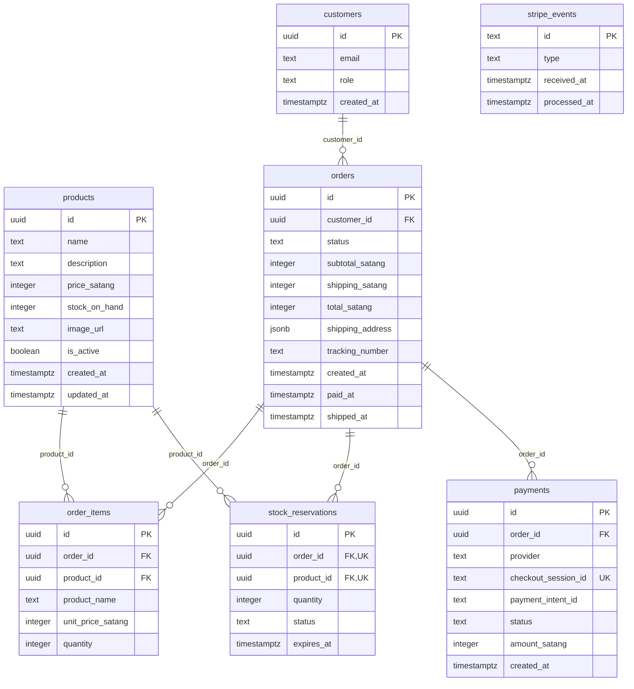

# Origin Lab: MVP Implementation Specification

## 1. Overview

Origin Lab is a **single-seller specialty coffee roaster online store**. Customers browse beans, brewing gear, mugs, and merch, pay through Stripe, and the owner fulfills orders manually.

## 2. Problem Statement

- **What are we building ?**
  - E-commerce website for a single seller coffee roaster
- **Target User**
  - **Customer** Browses coffee products, builds a cart, creates an account at checkout, pays, and views order history.
  - **Admin** Manages products and stock, views all orders, ships orders manually.
- **What is it look like** - a ecommerce website where customer can browse,checkout different type of coffee even the equipment to do it themself

## User Story / Features (MVP)

- A guest can browse, search, and filter the catalog without an account.
- A guest can build a cart that survives a page refresh.
- Checkout requires an AuthCore account; after login the cart is preserved.
- A customer can complete checkout with a Stripe **test** card and the order becomes `paid` **only via the webhook**.
- Failed or expired payment sets the order to `cancelled` and releases reserved stock.
- Stock is never oversold: the concurrency test (50 goroutines buying 10 units) passes with exactly 10 successes.
- The same Stripe event delivered twice changes order state exactly once.
- A webhook with an invalid signature is rejected.
- Prices and totals are always calculated server-side; client-sent prices are ignored.
- Admin can create/edit products and stock, view orders, and mark an order shipped with a tracking number.
- A non-admin customer receives 403 on every admin endpoint.
- Tokens from a different AuthCore `projectId` are rejected.
- All tests in the section 9 testing bar pass in CI or locally via Docker.

## ERD

